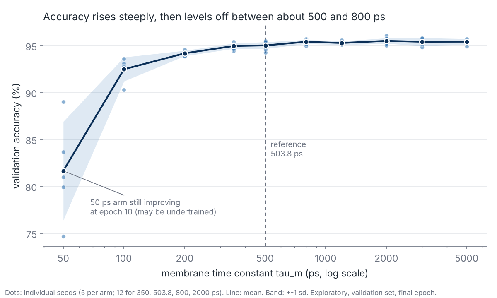
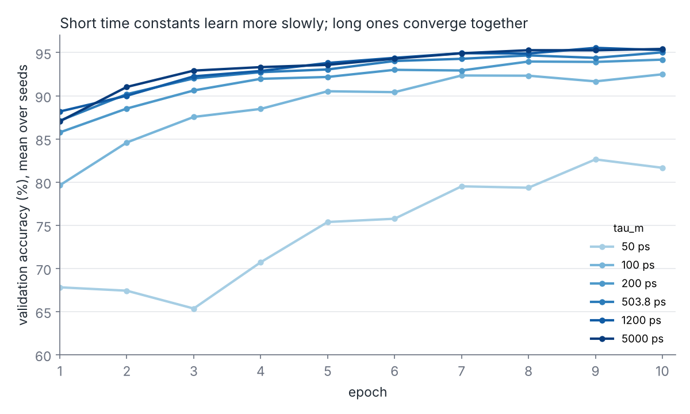
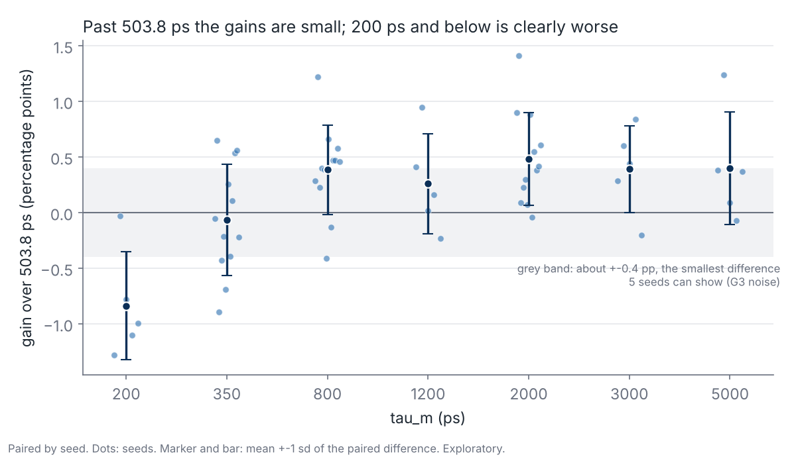
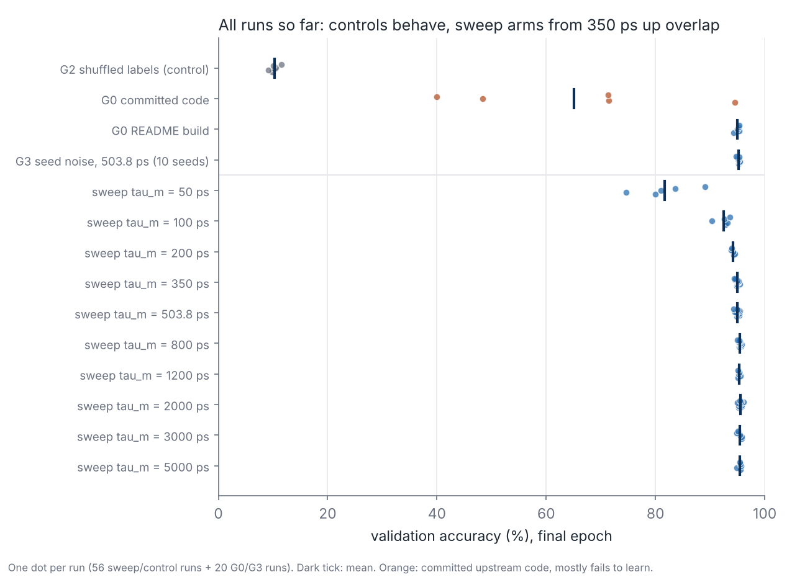
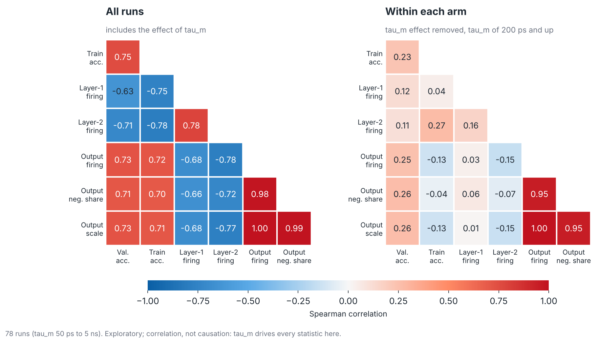
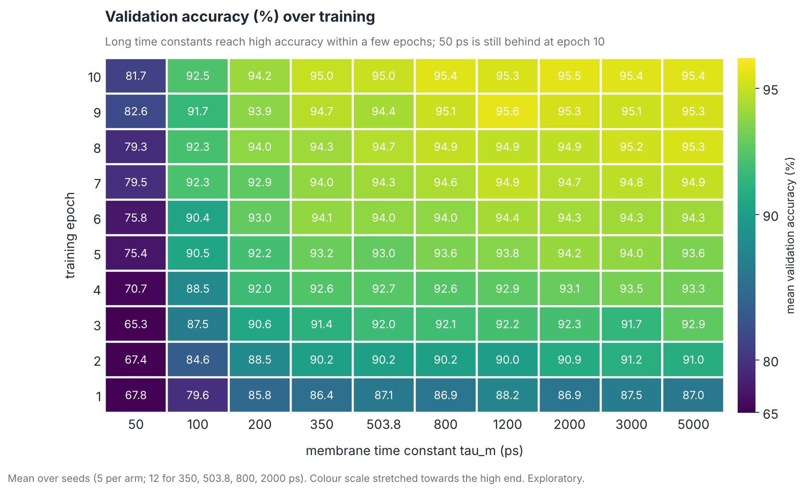

# ternary-snn-taum-study

Does the membrane time constant **tau_m** change the accuracy of the ternary MTJ-inspired spiking network
(Drexel group, `ternary_mtj/thmtj.py`), and why does accuracy rise and then saturate as the magnetic
anisotropy of the device grows? The design is pre-registered: read **`protocol/protocol.pdf`** first.

> **Status (26 Nov 2026).** Protocol v0.2 is a draft, not frozen, and no confirmatory run has been made.
> Gates G0 to G3 are done and the exploratory tau_m sweep (50 ps to 5 ns, 78 runs) is finished.
> Everything below is **exploratory**: validation accuracy only, one learning rate, fixed thresholds, 10 epochs,
> 5 seeds per arm (12 for tau_m = 350, 503.8, 800, 2000 ps). It points to hypotheses; it does not confirm any.

## Main findings (exploratory)

1. **Low tau_m costs accuracy.** tau_m of 200 ps and below is worse than the 503.8 ps reference in every seed. The 50 ps arm is also unstable and may be undertrained.
2. **Accuracy converges at about 800 ps and above.** 800 ps, 2 ns, 3 ns and 5 ns agree within about 0.1-0.3 pp; the knee lies between 503.8 and 800 ps (800 ps beats 503.8 ps by +0.39 pp, 95 % CI +0.13 to +0.64).
3. **No window effect.** Nothing changes past the 2.5 ns input window (hypothesis H6 not supported in 2-5 ns).
4. **Empirical law.** Accuracy = A - B (dt/tau_m)^p with A = 95.48 %, B = 3.8 pp, p = 1.59 (95 % bootstrap 1.33-1.86), dt = 100 ps. Leak time alone moves accuracy by only about 0.3 pp between 503.8 ps and the plateau.
5. **Caveat on regime.** Layer-1 neurons fire on about 93 % of neuron-steps in every arm, so the network is near saturation; the tau_m effect is for this regime only.

## Results by arm

Validation accuracy, final epoch. "Gain" is the mean same-seed difference from the 503.8 ps arm.

| tau_m (ps) | seeds | validation accuracy (%) | sd | gain over 503.8 ps (pp) |
|---:|---:|---:|---:|---:|
| 50 | 5 | 81.65 | 5.26 | -13.37 |
| 100 | 5 | 92.49 | 1.28 | -2.54 |
| 200 | 5 | 94.19 | 0.29 | -0.84 |
| 350 | 12 | 94.97 | 0.28 | -0.06 |
| 503.8 | 12 | 95.03 | 0.36 | reference |
| 800 | 12 | 95.42 | 0.21 | +0.39 |
| 1200 | 5 | 95.29 | 0.20 | +0.26 |
| 2000 | 12 | 95.51 | 0.29 | +0.48 |
| 3000 | 5 | 95.42 | 0.42 | +0.39 |
| 5000 | 5 | 95.43 | 0.30 | +0.40 |

## Checks that came first

| Check | Result |
|---|---|
| **G0** replication, README build | Final-epoch test accuracy 95.27 % vs the authors' 95.22 %. Best-epoch 95.45 % vs 95.89 %: a narrow miss on the pre-set +-0.3 pp rule, kept as "not passed" until a stricter test is run. |
| **G0**, committed code (negative threshold 1.6) | Mostly fails to learn (65 % final test accuracy, 1 of 5 seeds learned, no negative spikes). The README build reproduces the paper; the committed code does not. |
| **G1** neuron unit test | `leak()` and `integrate()` match Joy's closed forms to machine precision; tau_r(J) within 1-3 % of her fits; free-decay tau fits 523 ps (repo uses 503.8 ps). alpha x tau_leak is 5.0-5.7 ps. |
| **G2** shuffled labels | 9.2-11.5 % in all 6 runs: chance, no label leakage. |
| **G3** seed noise (503.8 ps, 10 seeds) | 95.20 +- 0.22 %, no failed seeds; pooled sd about 0.31 pp. Agrees with the sweep reference (p 0.44). The 503.8 ps sweep arm is bit-identical to G0 for the same seeds. |

## Statistics

Scripts in `runner/`, outputs in `results/`. Caveats: 5-12 seeds, validation set, exploratory.

* **Sweep, 5 seeds** (`stats_sweep.py`): 50, 100 and 200 ps are below the reference in 5 of 5 seeds each; only 50 ps survives Holm correction. Over 350 ps to 5 ns accuracy drifts up by +0.48 pp per decade (95 % CI +0.28 to +0.68).
* **12 seeds** (`stats_more.py`): 800 ps is above 503.8 ps by +0.39 pp (Holm p 0.020, 10 of 12 seeds); 2000 ps by +0.48 pp (Holm p 0.008); 350 and 503.8 ps are indistinguishable (-0.06 pp); 800 and 2000 ps are equivalent within +-0.3 pp. The 800 ps edge is smaller on the fresh seeds 5-11 (+0.30 pp) than on seeds 0-4 (+0.51 pp).
* **Curve fit** (`fit_tau_curve.py`): the power law beat an exponential and a leak-factor form. Poor below about 100 ps (the 50 ps arm sits 2.4 pp under the curve); do not extrapolate outside 100 ps to 5 ns.
* **Correlations** (`corr_sweep.py`): accuracy follows tau_m below 800 ps (rho +0.81) and not on the plateau (+0.12). Output-layer firing and negative-spike share rise with tau_m. Within an arm no run statistic predicts accuracy convincingly. Train minus validation accuracy is about +0.6 pp at every tau_m. Correlation only; tau_m drives all of these.
* **Predictions written before the extra seeds**: 800 vs 503.8 ps about +0.3 pp (observed +0.39), 800 vs 2000 ps under 0.3 pp (held), 350 vs 503.8 ps unresolved (held), seed sd 0.3-0.4 (observed 0.21-0.36). The case where the edge vanishes did not occur.

Caveats that matter: validation accuracy is measured on a fixed 10k hold-out of a 50k training split (the authors train on 60k).

## Figures

Regenerate figures 1-4 with `python runner\plot_sweep.py ledger\runs figures` and figures 5-6 with `python runner\plot_heatmaps.py ledger\runs figures`.

**1. Accuracy against tau_m.** One dot per seed; rises steeply, then levels off between about 500 and 800 ps.



**2. Learning curves.** Short time constants learn more slowly; the long ones converge together.



**3. Paired gain over the 503.8 ps reference.** 200 ps is clearly worse; beyond 503.8 ps the gains are small.



**4. Every run so far.** Shuffled labels sit at chance, the committed upstream code mostly fails to learn, the README build and seed-noise runs agree.



**5. Correlations.** Heat maps of Spearman correlations between accuracy and run statistics: all runs (left) and within each arm with tau_m removed (right).



**6. Heat map by tau_m and epoch.** Mean validation accuracy over training; long time constants reach high accuracy early, short ones are still behind at epoch 10.



## Physics behind the tau_m arms (`physics/`)

* `macrospin_tau.py`: LLG macrospin; tau_leak ~ 1 / (alpha (1 - Ku1 / K_c)), K_c about 5.6e5 J/m^3.
* `fit_tau_vs_ku1.py`: fit the leak constant from a mumax3 `table.txt`.
* `Ku1_tau_sweep.mx3`: mumax3 sweep over Ku1. **Untested above Ku1 = 2.5e5**; needs a fast GPU (gate G1b).

Damping alpha covers tau_m at or below 503.8 ps; anisotropy only lengthens it above 503.8 ps. See protocol rows 6, 10, 11, 13-17.

## Setup (Windows, PowerShell)
```powershell
git clone --recurse-submodules https://github.com/SKBiswas1998/ternary-snn-taum-study
cd ternary-snn-taum-study
python -m venv .venv
.\.venv\Scripts\Activate.ps1
pip install torch torchvision --index-url https://download.pytorch.org/whl/cpu
pip install numpy
```
Upstream (`upstream/mtj`, pinned submodule) is used verbatim: `runner/core_loader.py` slices out the neuron and
network classes and only overrides `THRESHOLD`, `NEG_THRESHOLD`, `TAU_LEAK_PS` before the model is built.

## Running
```powershell
python runner\selftest.py                       # runner checks; must pass
python runner\make_jobs.py g0                   # also: g2, g3, explore, ext, more
python runner\launch.py jobs\g0.csv --workers 3
python runner\collect.py                        # merge ledger and print summary
python runner\g1_neuron_check.py upstream\mtj\ternary_mtj\thmtj.py "<folder with LIF_equation_current_1>"
```
Job sets: `g0` replication (10), `g3` seed noise (10), `g2` shuffled-label control (6), `explore` tau_m sweep
50-1200 ps x 5 seeds (35), `ext` tau_m = 2, 3, 5 ns x 5 seeds (15, tests the 2.5 ns window, hypothesis H6), `more` seeds 5-11 on tau_m = 350, 503.8, 800, 2000 ps (28).
All except `g0` use the README build (negative threshold 0.90). `launch.py` is resumable: finished (arm, seed)
pairs are skipped. About 45 min per run with 3 workers on an i7-10510U, 8 GB; close other apps first
(about 0.85 GB per worker). To stop the laptop sleeping overnight see `powercfg /change standby-timeout-ac 0`.

## Rules the code enforces
* Test accuracy is computed only in phase `confirm` (once, final epoch) and phase `G0` (every epoch, to
  replicate the authors' best-test-epoch protocol). Exploratory and control phases use validation only.
* `collect.py` never prints test accuracy for `confirm` (blinding).
* Same seed gives the same initial weights and data order in every arm (paired design).
* Reserved seeds: explore/G0 0-4, G3 100-109, tune 200-201; confirm seeds are drawn at freeze.
* Finished runs are never re-run (diverged runs count as failures); crashes may be re-run.

## Layout
`protocol/` protocol source and PDF (v0.2) | `runner/` training, job generation, collection, G1 check |
`jobs/` job CSVs | `ledger/` one JSON per run and logs | `figures/` plots | `results/` statistics and fit outputs | `physics/` macrospin and mumax3 scripts | `upstream/mtj` pinned upstream code.

## Not done yet
* Check why accuracy stops depending on tau_m above about 800 ps: layer-1 neurons spike on 93 % of neuron-steps in every arm, so test other thresholds.
* Stricter replication of G0 (unmodified upstream script, seed 42, 60k training). The runner is the main suspect for the gap, so this is rerun whatever the sweep shows.
* Gate G1b: mumax3 at Ku1 of 3, 4, 5e5 on a fast GPU.
* Per-arm learning-rate tuning and more epochs (the 50 ps arm); a T = 50 control and a linear-leak arm (not yet in the runner).
* Protocol v0.3 (record G0-G3 and sweep results, rule for non-learning seeds), then freeze and confirmatory runs (12 seeds per arm, heavy part on Kaggle).
* Open questions in protocol Appendix C: which build produced the authors' number; Joy's accuracy-vs-anisotropy data and which device parameters she varied.
